# Velop Advanced Management Console

**A local, private web console that unlocks what the Linksys app hides on a Velop mesh system.**

It talks directly to the router's JNAP interface and gives you a searchable device list with live ping verification,
DHCP reservations, the router's hidden support bundle (logs), a browsable view of everything the router reports about
itself, the router's own internet speed test, and a full set of guarded administration controls, every one of them
backed up first and undoable.

It runs on your own computer and can be opened from your phone or any other device on the same network. Other devices
must enter an access password, and the router password never reaches the browser.

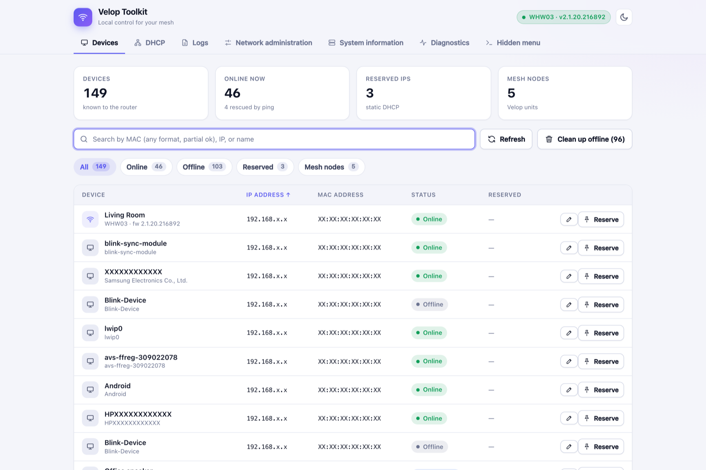

> This project is **unofficial**. It is not affiliated with, endorsed by, or supported by Linksys or Belkin.
> "Linksys" and "Velop" are trademarks of their owners. The JNAP interface is undocumented and can change between
> firmware versions. It was developed against a WHW03 v2 primary (firmware 2.1.20) with WHW01 nodes (firmware 1.1.13).
>
> In every screenshot below, IP addresses, MAC addresses and personal names have been masked.

## Highlights

- 🔎 **Find any device in seconds**: search by MAC in any format (even partial), IP, or name.
- 📡 **Trustworthy online status**: the router's own flag goes stale, so every device is also pinged live.
- 📌 **One-click DHCP reservations** straight from the device list or the lease table.
- 📜 **The hidden support bundle**: thousands of lines of router logs, split into sections and fully searchable.
- 🧭 **45 read-only probes** of everything the router knows about itself, each with a visual and a raw JSON view.
- 🚀 **Speed test run by the router itself**, with history, plus a ping run from the router.
- 🛠️ **Real administration**: Wi-Fi, switches, firewall, access control, port forwarding, schedules, firmware, mesh nodes.
- ↩️ **Backup and undo on every change**: the previous settings are saved before anything is written.
- 🧪 **A guarded JNAP console** (the "Hidden menu") for exploring any action the router advertises.
- 🌗 Light and dark themes, works on a phone.

## Tour of the console

The interface has seven tabs.

### Devices

Every device the router has ever seen, with summary tiles on top (known devices, online now, reserved IPs, mesh nodes).
Status combines the router's online flag with a live ping from this computer, so you can see the devices the router
wrongly reports as offline ("rescued by ping"). Each row shows the app-assigned name, vendor, mesh node and reservation,
and you can rename a device, reserve its IP, copy its IP or MAC, or clean out stale offline entries in bulk.


Search accepts a MAC in any format (`aa:bb`, `AA-BB`, `aabb…`, partial), an IP, or a name, and the filter chips
(All, Online, Offline, Reserved, Mesh nodes) narrow it further.

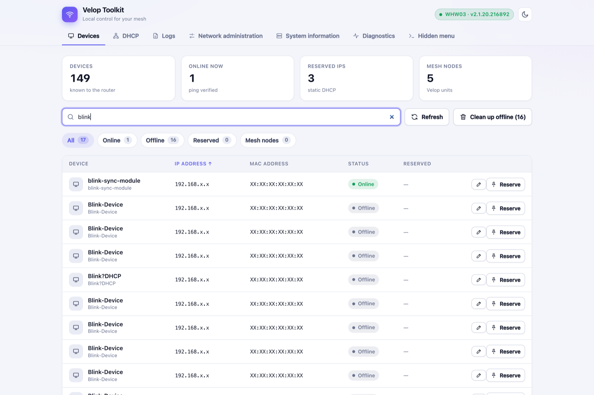

### DHCP

The LAN at a glance (network, address pool, lease time, DNS), the reservation table (add, edit, remove) and the live
lease table, where any lease can be turned into a reservation with one click.

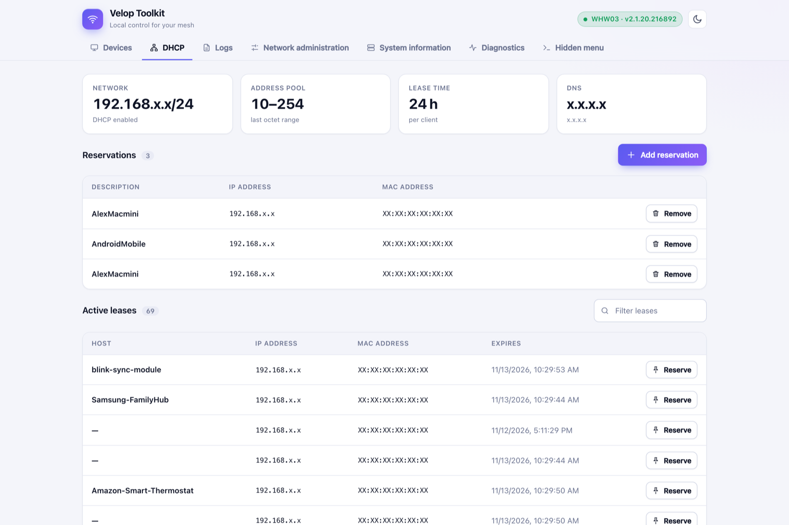

### Logs

The router's hidden support bundle (`diagnostics/GetSysinfoData`), split into its sections and searchable across all of
them at once: look up a MAC, an IP or an error word. The router builds the bundle on demand, so the first load takes
about 35 seconds; it is then cached for 2 minutes.

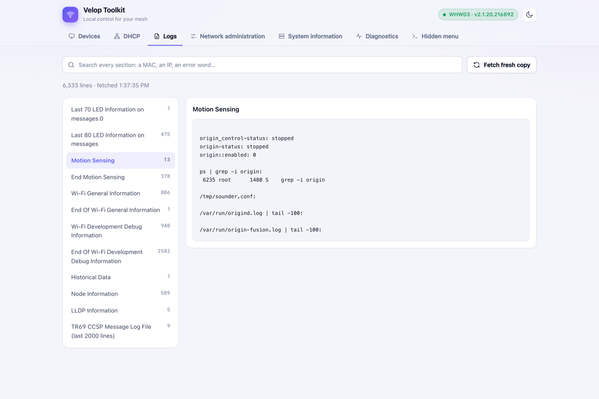

### Network administration

Everything that changes the router lives here. Each change reads the current settings, backs them up, writes, reads
back and verifies.

**Switches**: 17 on/off settings (guest network, WPS, UPnP, express forwarding, SIP ALG, LEDs, logging, parental
controls, remote management, client steering, HomeKit, and six firewall options), each with a plain-words explanation.
Security-relevant ones ask for confirmation.

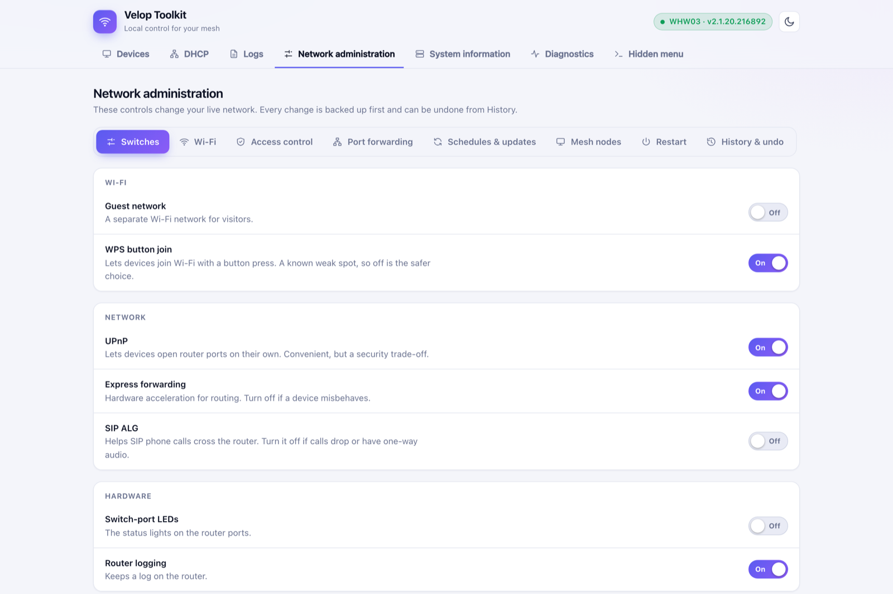

**Wi-Fi**: name, password and on/off per radio (2.4 GHz, 5 GHz low, 5 GHz high on a tri-band unit). The last radio that
is on cannot be switched off, and passwords are write-only.

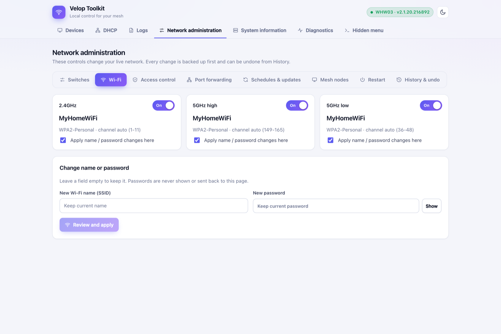

**Access control**: MAC allow or block list, and removal of parental-control rules. An empty allow list is refused,
because it would block every device including this computer.

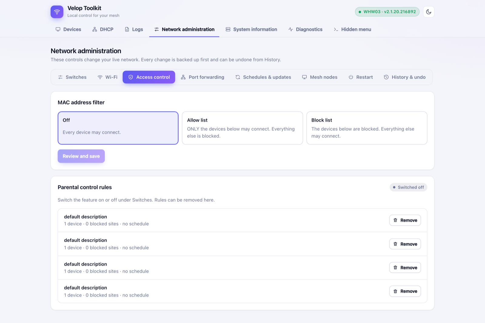

**Port forwarding**: add, edit, switch on or off, and remove single-port rules, with warnings for ports that are
dangerous to expose (VNC, Remote Desktop, SSH, SMB and so on). Port-range, triggering, IPv6 and DMZ rules are shown as
counts.

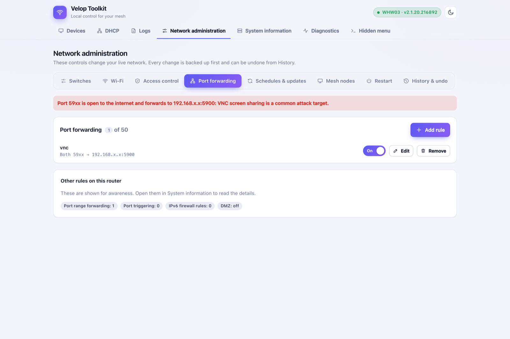

**Schedules & updates**: scheduled restart, firmware auto-update policy and window, and the router time zone.

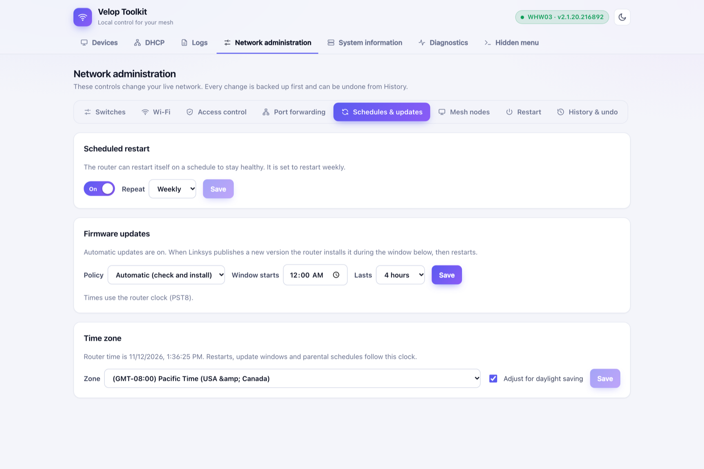

**Mesh nodes**: model, firmware, connection and last update check for every node, a plain-words verdict on whether the
nodes are up to date, and buttons to check for updates, install them, or refresh node data.

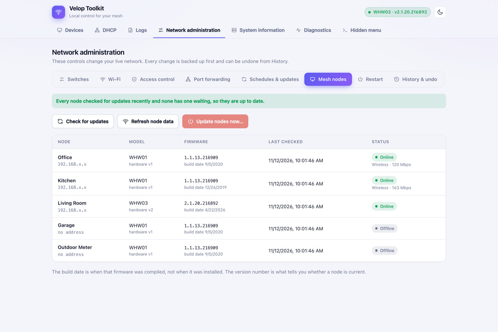

**Restart**: restarts the router (with typed confirmation), then watches until it answers again.

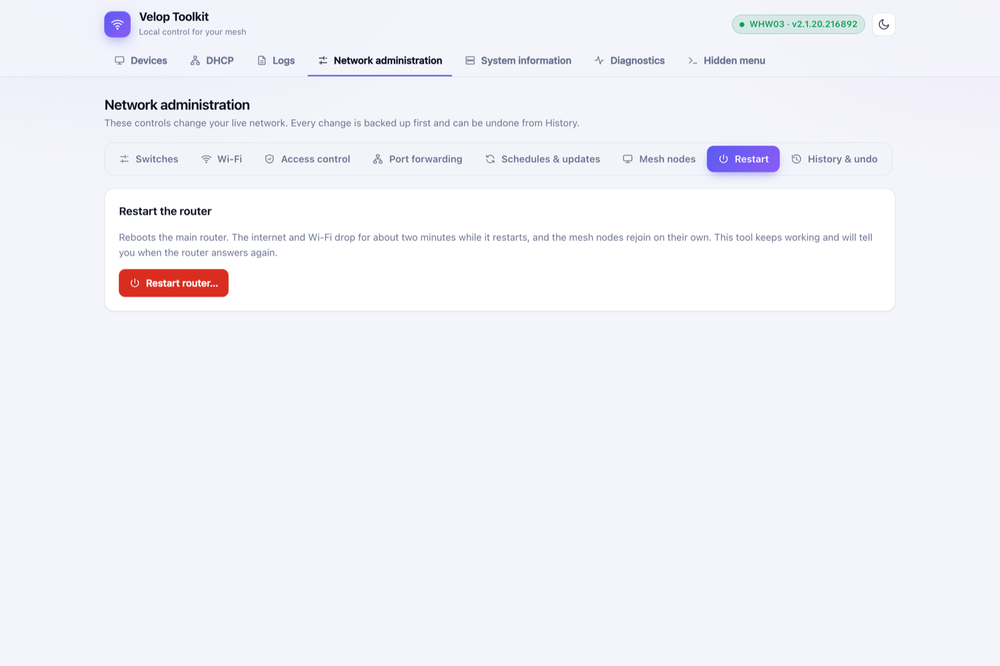

**History & undo**: every change saved a copy of the previous settings, and any reversible change can be put back with
one click.

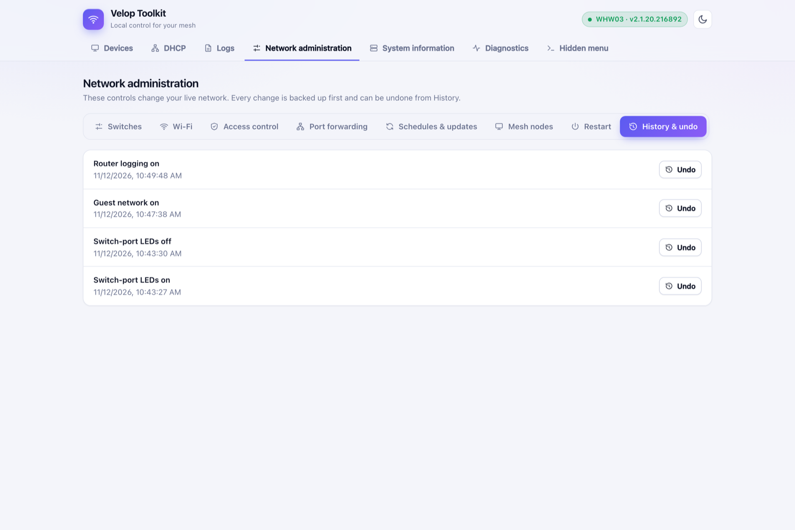

### System information

45 read-only probes in five categories (Internet, Wi-Fi, Mesh, Security, System): WAN settings and status, Ethernet
ports, IPv6, routing and NAT, DDNS, QoS, radios, backhaul, firewall, firmware and more. Each one has a Visual and a raw
JSON view, and shows the JNAP action it called.

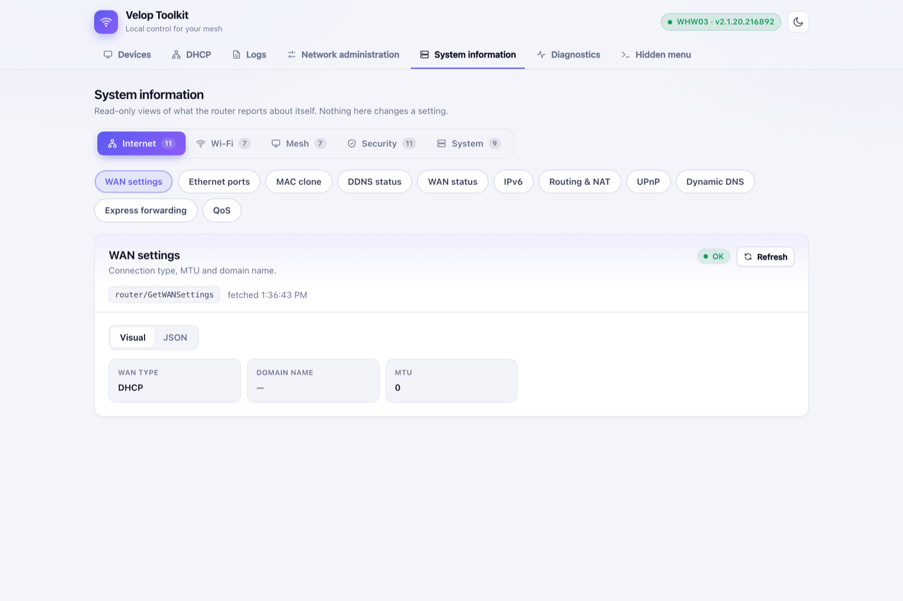

### Diagnostics

Router health tiles (uptime, internet, logging, backhaul links), the router's own **speed test** with progress and a
history of past results, and a ping run from the router itself to test its own path to the internet.

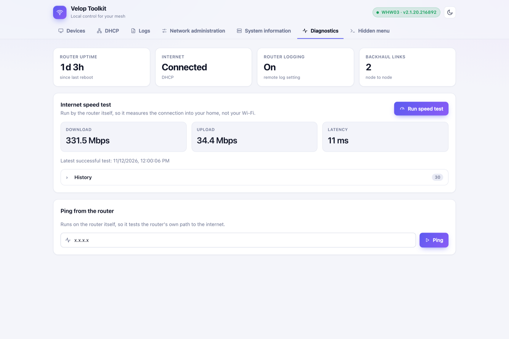

### Hidden menu

A guarded console for any JNAP action the router advertises. Preset chips run read-only actions immediately, a
"What can I send?" helper asks the router what an action accepts and returns, and actions that change the router
(`Set*`, `Start*`, `Reboot`…) stay locked until you explicitly allow them. Dangerous actions are blocked outright.

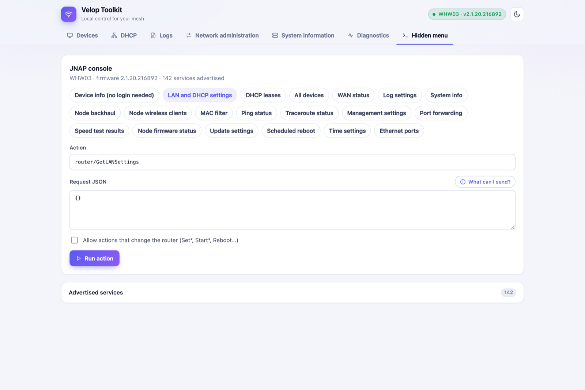

### Dark mode

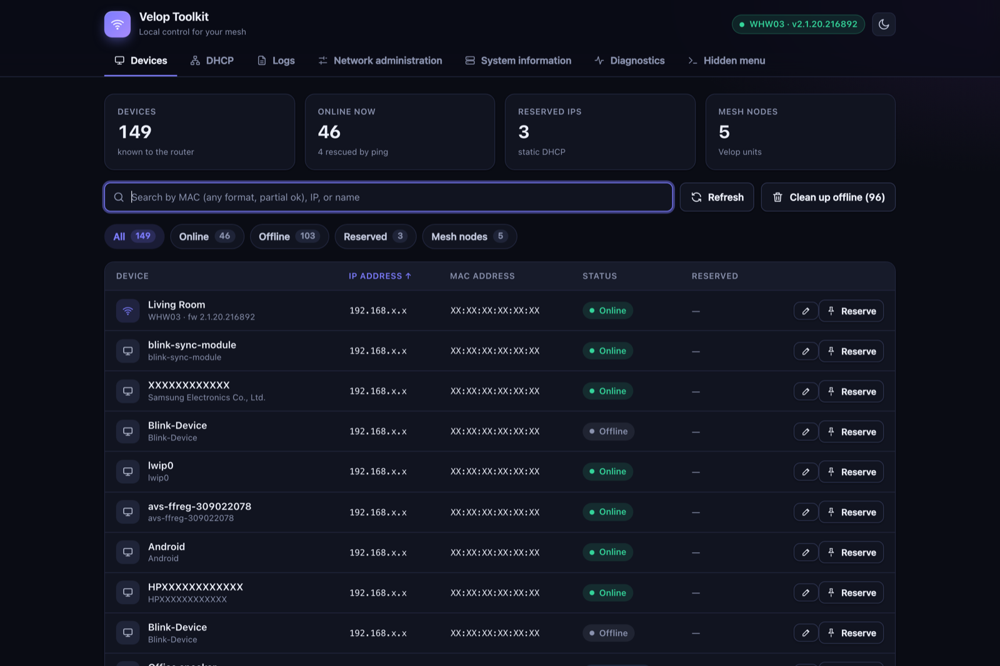

## Requirements

- Node.js 26 or newer (`nvm use` reads `.nvmrc`)
- A Linksys Velop reachable from this computer, and its admin password

## Setup

```bash
nvm use                          # Node 26
npm install
npm --prefix client install
cp .env.example .env             # then fill in ROUTER_PASSWORD and ACCESS_PASSWORD
npm run build
npm start                        # prints the address to open, e.g. http://192.168.1.20:3001
```

On this computer open `http://127.0.0.1:3001`. From another device on the same network open the address the server
prints at start-up, and enter `ACCESS_PASSWORD` when asked (any user name works). The first time, macOS may ask whether
Node may accept incoming connections: allow it.

`.env` keys, read in one place (`server/config.js`) and validated at start-up:

| Key                               | Default                       | Meaning                                                                                                                         |
| --------------------------------- | ----------------------------- | ------------------------------------------------------------------------------------------------------------------------------- |
| `ROUTER_PASSWORD` (or `ROUTERPW`) | none, required                | Router admin password                                                                                                           |
| `ROUTER_USER`                     | `admin`                       | Router admin user                                                                                                               |
| `ROUTER_HOST`                     | `192.168.1.1`                 | Router address                                                                                                                  |
| `PORT`                            | `3001`                        | Port this tool listens on                                                                                                       |
| `ACCESS_PASSWORD`                 | none, required on the network | Password other devices must enter, 8 or more characters. Requests from this computer are exempt.                                |
| `BIND_ADDRESS`                    | `0.0.0.0`                     | `0.0.0.0` listens on the network. Set `127.0.0.1` to keep the tool on this computer only; the access password is then optional. |
| `ALLOWED_ORIGIN`                  | `http://localhost:5173`       | Dev-server origin allowed by CORS                                                                                               |
| `REQUEST_TIMEOUT_MS`              | `30000`                       | Per-request timeout to the router (the router can take 5 to 10 s for the device list)                                           |
| `DATA_DIR`                        | `./data`                      | Where settings backups are written                                                                                              |

`.env` and `data/` are ignored by git. Keep them private.

Development with live reload: run `npm run dev:server` and `npm run dev:client` in two terminals, then open
`http://localhost:5173`. Checks: `npm test`, `npm run lint`, `npm run format`.

## Safety model

- **Network access is password protected.** By default the tool listens on all interfaces so a phone can use it. The
  server refuses to start on the network without `ACCESS_PASSWORD`. Other devices sign in with HTTP Basic auth (compared
  in constant time), and an address that guesses wrong ten times is locked out for ten minutes. This computer is exempt.
- The connection is plain HTTP, so the password could be read by someone who can capture traffic on your network. Use
  it only on a network you trust, never forward its port through the router, and set `BIND_ADDRESS=127.0.0.1` if you
  do not need other devices.
- Every non-GET request needs a custom header, so other web pages cannot drive the router. The security headers
  deliberately omit the HTTPS-forcing options (`upgrade-insecure-requests`, HSTS), which would break plain-HTTP use.
- **Login lockout protection.** After one rejected login the server stops contacting the router until it is
  restarted. Velop locks the admin account after repeated failures, and a wrong password in a loop will lock you out of
  the router's own web page too. Test a new password with one call, never in a loop.
- Risky actions need typed confirmation (Wi-Fi changes, restart, node firmware update, device cleanup), and the
  server enforces the exact phrase, not just the page.
- Every change goes through one path (`server/services/settingsWrite.js`): read the current settings, change a copy,
  **back up the original**, write, read back, and verify. If the router names a field it rejects, that field is dropped
  and the write retried. A rejected request changes nothing.
- Backups are written to `data/` before every change. They can contain Wi-Fi passwords, so the folder is owner-only
  (0700, files 0600) and ignored by git. Do not share it.
- Passwords are write-only: no endpoint returns one, and the router's habit of echoing the login header in error text
  is redacted.
- Some changes cannot be undone: a restart, a firmware update, and removing device-list entries. They are recorded but
  never replayed from History.
- Pinging is restricted to private LAN addresses.

## Status: what has been proven on real hardware

The author verified these against a real router, then restored the original settings:

- the router LED switch
- the guest network switch, including undo from the saved backup
- the speed test (start, progress, result)
- every read-only view

The rest of the write features follow request shapes used by other open-source clients and are covered by tests against
a fake router, but **have not been run on a real router yet**: Wi-Fi settings, MAC filter mode names (`Allow` and
`Deny`), parental rule removal, the firewall, UPnP, WPS, HomeKit, client-steering and remote-management switches, port
forwarding, scheduled restart, firmware policy, time zone, device rename and removal, node firmware actions, and the
restart. One of these shapes was already wrong once (the speed test rejected a field copied from another client), so
expect to fix more the same way. A rejected request changes nothing and shows the router's own message, which names
the offending field. Try each on a low-risk setting first, and read History before relying on undo.

**Deliberately not built**

- Per-device traffic bytes: the router exposes no byte counters, so none are shown.
- Blinking a node's light to identify it: the request format is not published.
- Running a command on the router (`diagnostics/ExecSysCommand`), changing the admin password, factory reset, and
  restoring previous firmware. They exist in other clients, but they are dangerous and are blocked in the console.

## API

All paths are under `/api`. Reads are `GET`. Anything that changes the router is a non-GET and needs the
`X-Velop-Tool: 1` header plus a confirmation field.

| Area           | Endpoints                                                                                                                                          |
| -------------- | -------------------------------------------------------------------------------------------------------------------------------------------------- |
| Basics         | `GET /health`, `GET /info`, `GET /overview`                                                                                                        |
| Devices        | `GET /devices?q=&refresh=1`, `POST /devices/probe` (ping), `POST /admin/devices/:id/rename`, `POST /admin/devices/delete`                          |
| DHCP           | `GET /dhcp`, `POST /dhcp/reservations`, `DELETE /dhcp/reservations/:mac`                                                                           |
| Logs           | `GET /sysinfo`, `GET /sysinfo/section?name=`, `GET /sysinfo/search?q=`                                                                             |
| System info    | `GET /system/catalog`, `GET /system/probe/:id`                                                                                                     |
| Hidden menu    | `GET /explorer/actions`, `GET /explorer/describe?action=`, `POST /explorer/call`                                                                   |
| Diagnostics    | `GET`/`POST /diagnostics/ping`, `GET`/`POST`/`DELETE /admin/speedtest`                                                                             |
| Administration | `/admin/controls`, `/admin/wifi`, `/admin/access`, `/admin/port-forwarding`, `/admin/schedules`, `/admin/nodes`, `/admin/reboot`, `/admin/backups` |

## Project layout

```
server/
  index.js            starts the listener (wiring only)
  app.js              middleware, CORS, error handler, route wiring
  config.js           the only reader of process.env
  clients/            jnapClient.js, the one place that talks to the router (auth, timeouts, redaction, lockout guard)
  routes/             adminRoutes.js; routes validate input and call services
  services/           business logic, one file per feature (+ mockRouter.js, the fake router used by tests)
  lib/                httpError, network helpers, route helpers, backup store
client/
  src/components/     one React component per file
  src/hooks/          useAsync, useDebounced, useToast
  src/lib/            pure helpers with tests (status, formatting, JSON labelling, update verdict)
  src/api.js          all HTTP to the local server
  src/styles.css      design tokens, light and dark themes
scripts/
  probeActions.js     read-only helper: asks the router which actions it recognises
data/                 settings backups (created at runtime, ignored by git)
```

Conventions: ESM only, Node's built-in test runner (`node:test`), Prettier and ESLint, braces on every `if`, services
never call the router in a per-row loop, and every router write goes through `changeSettings` or `sendSet`.

## Troubleshooting

- **"Router rejected the admin credentials"** or the router's own page stops accepting your password: stop the server,
  wait for the lockout to clear (minutes to an hour, or unplug the main node for 30 seconds), fix `.env`, then start
  again.
- **Cannot reach it from a phone**: use the address printed at start-up, stay on the same Wi-Fi (a guest network is
  usually isolated), allow incoming connections if macOS asks, and check `ACCESS_PASSWORD` in `.env`.
- **"ACCESS_PASSWORD is required" or "must be at least 8 characters" on start**: the tool listens on the network, so
  `.env` needs an `ACCESS_PASSWORD` of 8 or more characters. Or set `BIND_ADDRESS=127.0.0.1` to keep the tool on this
  computer only.
- **`EADDRINUSE` on start**: another copy is already running. Stop it with `pkill -f "node server/index.js"`.
- **Logs tab is slow**: the router builds the support bundle on demand (about 35 seconds). It cannot return a single
  section, so the whole bundle is fetched once and cached for 2 minutes.
- **A device shows Online though the router says offline** (or the reverse): the router's flag goes stale, which is
  why the tool also pings. Hover the badge for the explanation.
- **A node shows an old firmware date**: that field is a build timestamp inside the firmware, not an install date.
  Compare the version number with Linksys's download page instead.

## Credits and attribution

The request names, field names and behaviours used here were learned from the open-source community's earlier work on
the same interface, and from reading the router itself. **No source code from these projects is included.** Only facts
about the protocol (endpoint, header names, action names, field names, accepted values) were used, and everything was
written from scratch. None of the projects below state a license in the repository, so please check with their authors
before copying any of their code.

- [uvjim/pyvelop](https://github.com/uvjim/pyvelop) and its Home Assistant integration
  [uvjim/linksys_velop](https://github.com/uvjim/linksys_velop): the broadest public list of Velop JNAP actions,
  including health check (speed test), scheduled reboot, node refresh and device property actions.
- [linksys/PrivacyGUI-JNAP](https://github.com/linksys/PrivacyGUI-JNAP): the Dart JNAP client published under the Linksys
  GitHub organization. Source for many action names and request shapes (firewall and port forwarding rules, firmware
  update policy values, node firmware check and update, device delete and rename).
- [reujab/linksys](https://github.com/reujab/linksys) (Go), [jakekara/jnap](https://github.com/jakekara/jnap) and
  [jnap on PyPI](https://pypi.org/project/jnap/) (Python): documentation of the JNAP wire format (POST to `/JNAP/`,
  the `X-JNAP-Action` and `X-JNAP-Authorization` headers, basic auth as `admin`).
- Security background: the [CVE-2019-16340 advisory](https://starlabs.sg/advisories/19/19-16340/) and the
  [Velop information leak write-up](https://puzzor.github.io/Linksys-Velop-Information-Leak), which explain why the tool
  never exposes the router to the network and avoids unauthenticated calls.

Thank you to everyone who published their findings.
